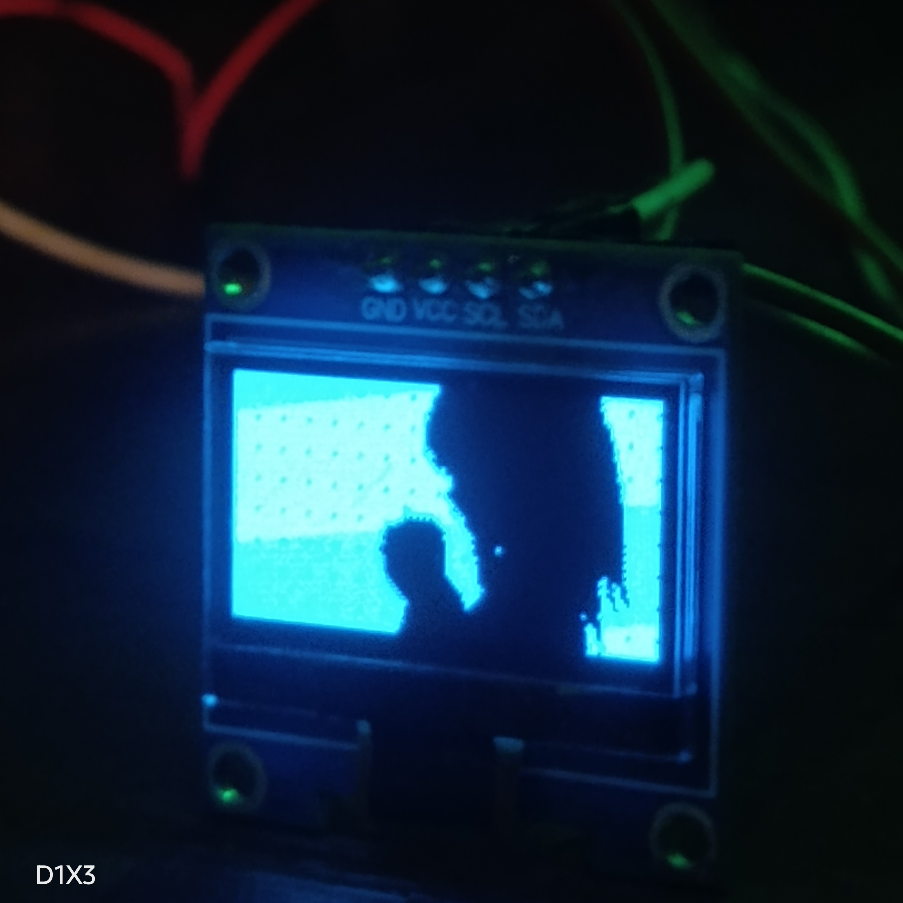

# BAD APPLE ON ESP8266
# WARNING: YOU NEED A NODEMCU v3!!!!!!!

for upload use:

```
pio run -t upload    
pio run -t uploadfs
```
## Credits
The initial boilerplate code and RLE algorithm were generated with AI assistance. Hardware integration, platform configuration, and debugging were done by me.




